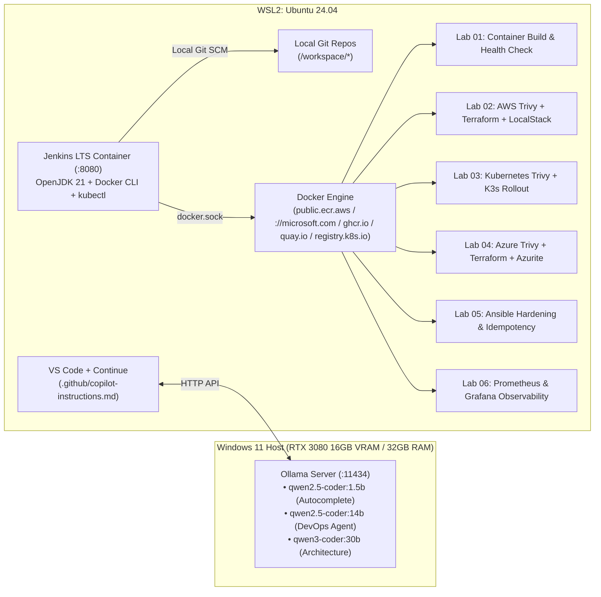

# Local AI DevOps & Cloud Workstation

A production-style, **100% local AI-assisted DevOps, Cloud & SRE engineering workstation** running on Windows 11 + WSL2 (Ubuntu).

This repository provides tested configurations, Dockerfiles, and CI/CD labs to run local LLMs on an NVIDIA GPU alongside **VS Code**, **Continue**, **Docker**, **Terraform**, **Kubernetes (K3s)**, **Ansible**, **Prometheus**, **Grafana**, **Trivy**, **LocalStack (AWS)**, **Azurite (Azure)**, and a containerized **Jenkins** controller—with zero cloud API costs and zero Docker Hub (`docker.io`) CDN dependency.

## Architecture Overview



## Repository Structure

| Path | Description |
| :--- | :--- |
| `.github/copilot-instructions.md` | AI engineering guardrails enforcing least-privilege IAM, KMS encryption, non-root containers, K8s security contexts, and Declarative Jenkinsfiles. |
| `configs/` | `.wslconfig` resource cap and `continue-config.yaml` dual-model VRAM setup. |
| `jenkins/Dockerfile` | Custom OpenJDK 21 + Docker CLI Jenkins controller built without Docker Hub dependencies. |
| `starter-lab/` | **Lab 01:** Multi-stage Python API image build + Docker bridge IP health check pipeline. |
| `lab-02-aws-terraform-trivy/` | **Lab 02:** DevSecOps AWS pipeline with Trivy IaC scanning, LocalStack S3/KMS emulation, Terraform provisioning, and AWS CLI verification. |
| `lab-03-kubernetes-kind/` | **Lab 03:** Hardened Kubernetes CI/CD pipeline with Trivy K8s scanning, self-contained K3s node (`registry.k8s.io/pause:3.10`), 2-replica rollout, and smoke testing. |
| `lab-04-azure-terraform-azurite/` | **Lab 04:** Azure DevSecOps pipeline with Trivy AzureRM scanning, Terraform `fmt`/`validate`, Azurite Blob Storage emulator, and Azure CLI verification. |
| `lab-05-ansible-hardening/` | **Lab 05:** Ansible server hardening & Nginx deployment pipeline with `ansible-lint`, `changed=0` idempotency gate, and security header checks. |
| `lab-06-prometheus-grafana/` | **Lab 06:** SRE observability pipeline validating Prometheus configs/alerts (`promtool`), scraping metrics from Python API + Node Exporter, and verifying Grafana provisioning. |
| `scripts/explain-log.sh` | CLI helper to diagnose failed Jenkins/Terraform/K8s logs using your local GPU Ollama server. |

## Quick Start Guide

### 1. Configure Ollama on Windows (PowerShell)
Install [Ollama](https://ollama.com), set the environment variables below, and restart Ollama from the system tray:

```powershell
setx OLLAMA_CONTEXT_LENGTH 16384
setx OLLAMA_HOST 0.0.0.0
setx OLLAMA_MAX_LOADED_MODELS 2
```

Pull the models:
```powershell
ollama pull qwen2.5-coder:1.5b   # Inline autocomplete (~1 GB)
ollama pull qwen2.5-coder:14b    # Daily DevOps Chat/Agent (~9 GB)
ollama pull qwen3-coder:30b      # Deep architecture & refactoring (~18 GB)
```

*(Optional)* Copy `configs/.wslconfig` to `C:\Users\<YourUsername>\.wslconfig` and run `wsl --shutdown` to cap WSL2 memory at 14 GB.

### 2. Configure VS Code + Continue (`WSL: Ubuntu`)
1. Copy `configs/continue-config.yaml` to `~/.continue/config.yaml`.
2. Disable GitHub Copilot inline completions (bottom-right status bar) so **Continue** handles ghost-text suggestions without UI overlap.
3. Connect VS Code to **WSL: Ubuntu** and copy `.github/copilot-instructions.md` into your repositories to enforce infrastructure best practices automatically.

### 3. Build & Launch the Local Jenkins Controller
```bash
cd jenkins/

HOST="ftp.belnet.be"
PATH_WAR="mirror/ftp.jenkins-ci.org/war-stable/latest/jenkins.war"
curl -fL "https://HOST/{PATH_WAR}" -o jenkins.war

docker build -t local-jenkins-docker:lts .
```

Start the container with host Docker socket access, mounted `kubectl`/`kind` binaries, and local Git SCM checkout enabled:
```bash
DOCKER_GID=\$(stat -c '%g' /var/run/docker.sock)

docker run -d \
  --name jenkins-local \
  --restart unless-stopped \
  -p 8080:8080 \
  -p 50000:50000 \
  --group-add "\$DOCKER_GID" \
  -v jenkins_home:/var/jenkins_home \
  -v /var/run/docker.sock:/var/run/docker.sock \
  -v /usr/local/bin/kind:/usr/local/bin/kind:ro \
  -v /usr/local/bin/kubectl:/usr/local/bin/kubectl:ro \
  -v "\$HOME/local-ai-devops-workstation:/workspace/local-ai-devops-workstation:ro" \
  local-jenkins-docker:lts \
  java -Djava.awt.headless=true -Dhudson.plugins.git.GitSCM.ALLOW_LOCAL_CHECKOUT=true -jar /usr/share/jenkins/jenkins.war
```

Trust the mounted Git repository inside Jenkins and retrieve the initial admin password:
```bash
docker exec jenkins-local git config --global --add safe.directory /workspace/local-ai-devops-workstation/.git
docker exec jenkins-local git config --global --add safe.directory /workspace/local-ai-devops-workstation
docker exec jenkins-local cat /var/jenkins_home/secrets/initialAdminPassword
```

## License
MIT License
